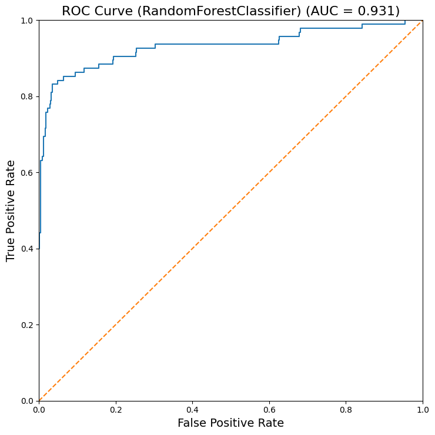

# Telecom Customer Churn Prediction

Seven supervised classifiers compared on an imbalanced telecom churn dataset, with ROC–AUC as the main ranking metric and accuracy/confusion matrices as complementary measures.

**[Full report](docs/report.pdf)** · [Data exploration](notebooks/01_data_exploration.ipynb) · [Model comparison](notebooks/02_model_comparison.ipynb)

## Objective and data

Can account characteristics, service plans, usage, and support calls distinguish customers who churn from those who remain? The supplied Telecom Churn split contains **2,666 training customers** and **667 test customers**. Churn prevalence is 14.6% in training and 14.2% in testing; predicting the majority class gives roughly 85% accuracy.

The analysis drops four charge columns that are mechanically related to minutes, ordinal-encodes categorical inputs, and standardizes predictors using training-set statistics. PCA is exploratory only. Fifteen predictors remain, including state and area code. See [data provenance](data/README.md).

## Experiment and reported results

Logistic regression serves as a baseline. The other models use shuffled 10-fold `KFold` cross-validation, ROC–AUC grid-search scoring, and seed 42 where specified. These are the original report and saved-result values, not smoke-test scores:

| Model | Test ROC–AUC | Test accuracy |
| --- | --- | --- |
| Random forest | **0.931** | 93.85% |
| SVM (RBF) | 0.930 | 91.60% |
| Bagging | 0.920 | **95.80%** |
| K-nearest neighbors | 0.861 | 87.26% |
| Decision tree | 0.855 | 93.25% |
| Logistic regression | 0.826 | 85.31% |
| Ridge classifier | 0.819 | 85.61% |

Random forest ranks highest by AUC; bagging has the highest test accuracy. The saved bagging confusion matrix still contains 23 missed churners out of 95, illustrating why accuracy alone is insufficient.



[Compact metrics and fitted parameter descriptions](results/model_summary.csv) · [Complete historical evaluation export](results/model_evaluation_original.csv)

## Reproduce or check execution

Use Python 3.11/3.12. From this repository:

```bash
python -m venv .venv
# Windows: .venv\Scripts\Activate.ps1
# macOS/Linux: source .venv/bin/activate
python -m pip install -r requirements.txt
jupyter lab
```

Run `notebooks/01_data_exploration.ipynb`, then `notebooks/02_model_comparison.ipynb` with the environment's kernel. Both work when opened from the root or `notebooks/` directory. **`SMOKE_TEST=True` is the default:** modeling uses 128 training / 64 test observations, one candidate per search, and two folds. These classical estimators have no epoch setting; this is a small execution check rather than the full search.

For the original experiment, explicitly set `SMOKE_TEST=False` in both notebooks. Model comparison reads the preserved processed CSVs; fresh preprocessing exports go into `results/rerun/` for comparison. To model freshly processed data, point its two input paths there. Reruns never overwrite the historical evaluation table.

## Structure and limitations

`data/raw/` and `data/processed/` retain the small source and transformed splits; `notebooks/` contains the analyses; `src/evaluation.py` contains shared metrics/plots; `results/`, `figures/`, and `docs/` hold the historical evidence.

Preprocessing was fitted before cross-validation, so validation folds share preprocessing statistics. Ordinal state encoding imposes an arbitrary order, and the search uses non-stratified folds. These choices are preserved to keep the original methodology visible. The single test split and lack of uncertainty estimates limit claims about the close AUC ranking. Calibration, precision/recall, threshold costs, and independent datasets are extensions, not completed work. See [research notes](docs/research-notes.md).

Genrikh Vetsler · Undergraduate machine learning project.
